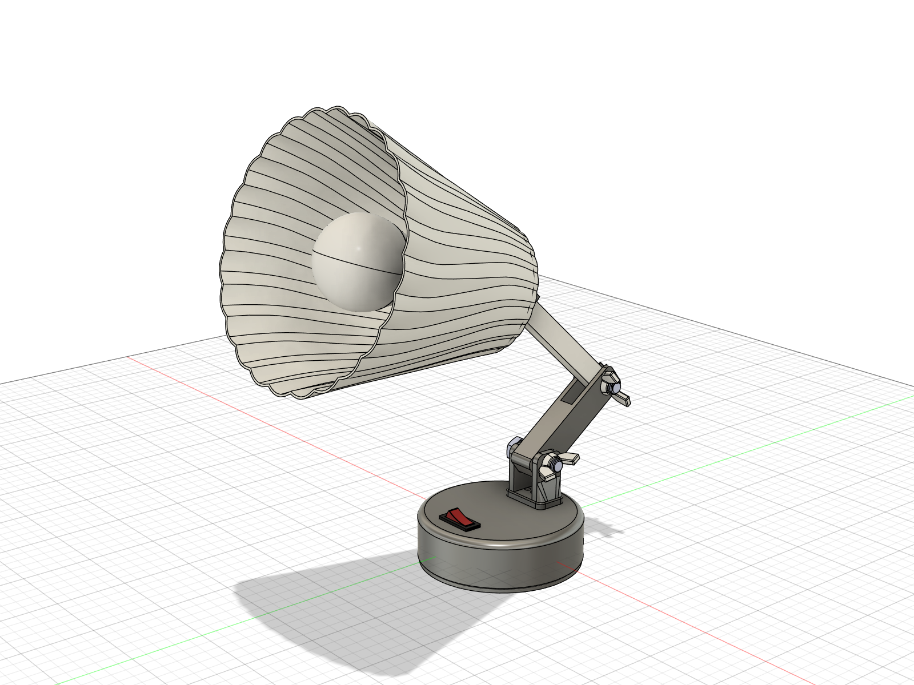
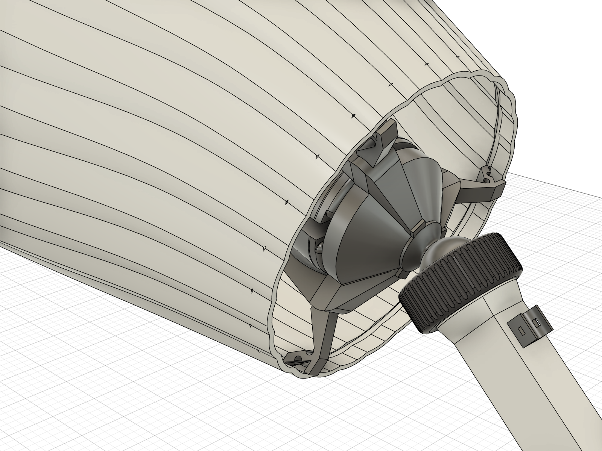
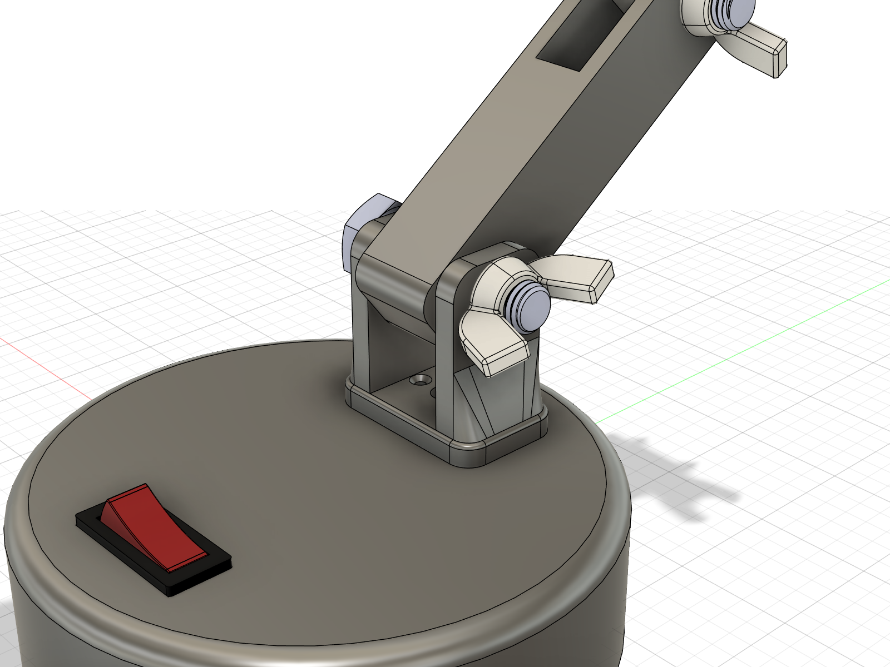
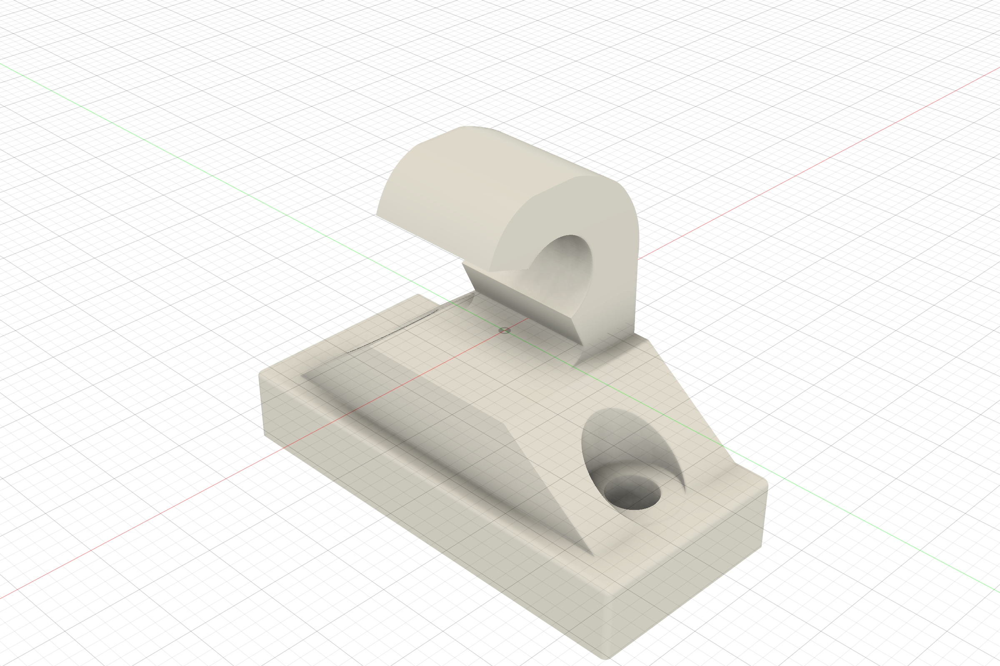
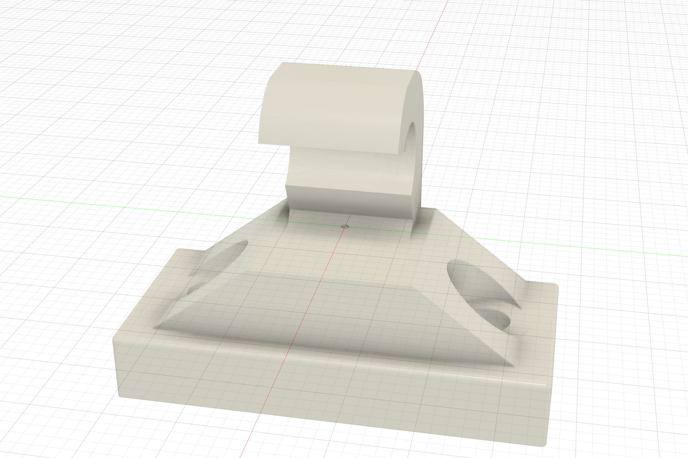
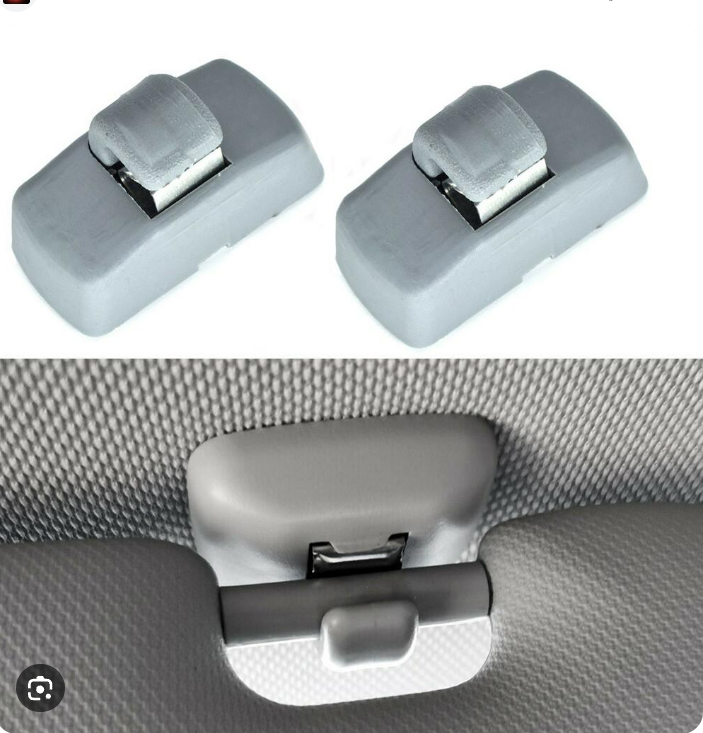
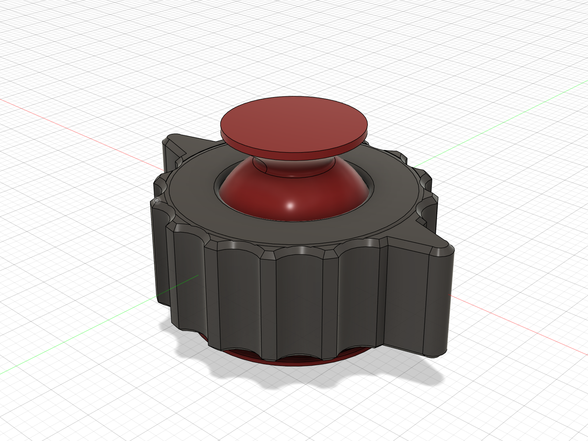
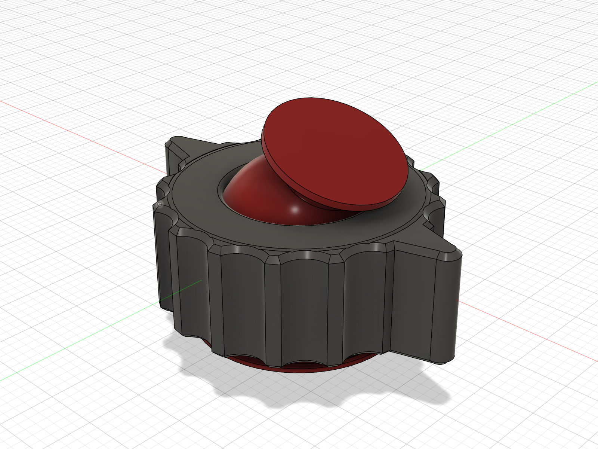
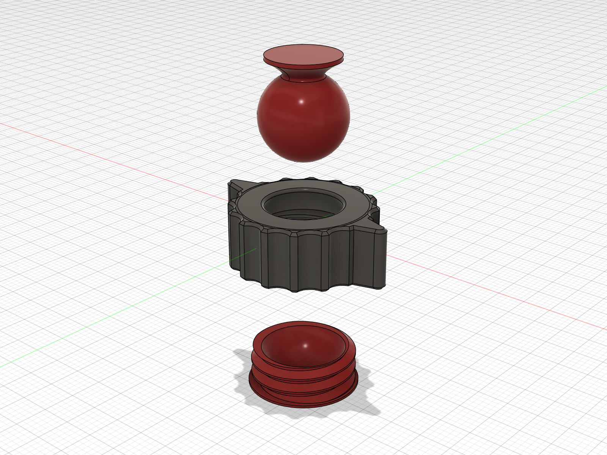
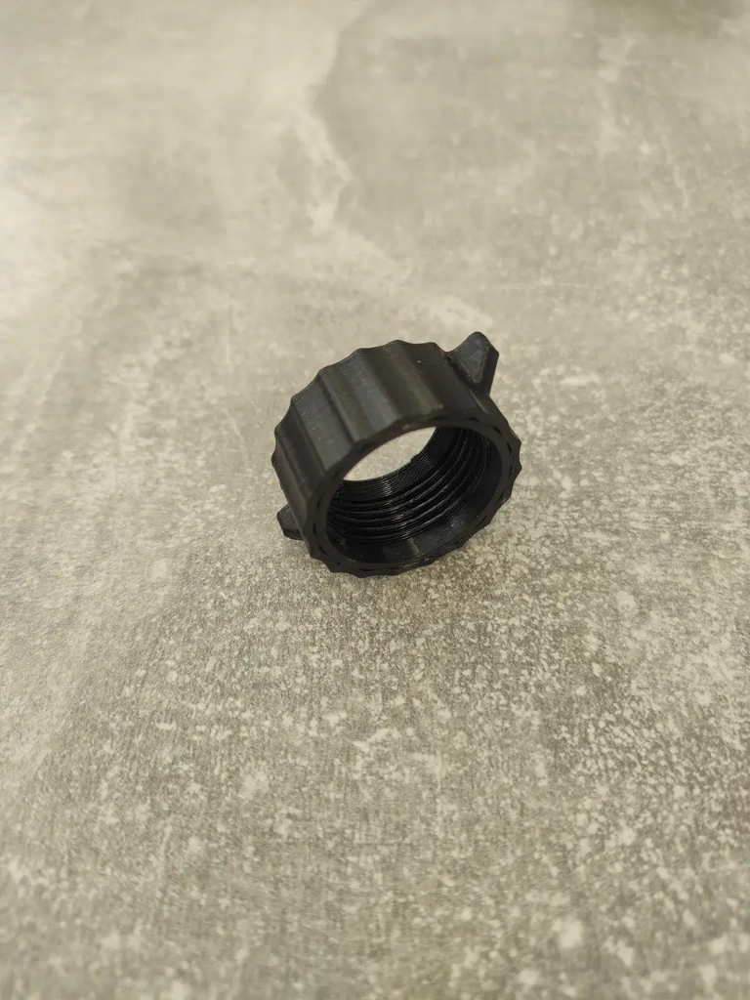

# Mark Smolyarchuk — CAD & Mechanical Design Portfolio
### Parametric CAD Modeling • Reverse Engineering • DFM for Additive & Injection Molding • Mechanical Assemblies

Welcome to my professional CAD engineering portfolio. I specialize in **parametric mechanical design**, **precision reverse engineering**, **Design for Manufacturing (DFM)** for 3D printing and injection molding, and **CAD workflow automation** using Autodesk Fusion 360 and Python.

> 🌐 **Interactive Web Portfolio**: View high-resolution galleries and interactive 3D WebGL models on GitHub Pages:  
> 👉 **[mark-314159265.github.io/CAD-Portfolio](https://mark-314159265.github.io/CAD-Portfolio/)**

---

## 🚀 Projects

### 1. Parametric Fluted Articulated Desktop Lamp (Luminaire)
* **Objective**: Complete end-to-end design of an articulated parametric desk luminaire featuring multi-axis kinematics, modular toolless bayonet shade assembly, and integrated electronic hardware.
* **Key Achievements**:
  * Complete top-down parametric assembly ($184 \times 302 \times 344\text{ mm}$) modeled in Autodesk Fusion 360.
  * 24-rib fluted conical shade bell optimized for functional light diffusion and structural hoop strength.
  * Toolless 3-lug bayonet collar with $0.8\text{ mm}$ positive tactile locking detents for rapid shade detachment.
  * Dual articulated cantilever arms with M10 hardware and custom high-leverage wing nuts for effortless friction adjustment.
  * Multi-axis spherical neck swivel joint for precise illumination angle targeting.
  * Stable weighted base with integrated rocker power switch and concealed internal cable routing channels.
* **Files**: [Complete Assembly STEP](models/desktop_lamp_assembly.step) • [Complete Assembly STL](models/desktop_lamp_assembly.stl) • [Socket STEP](models/000_Bocal_Ceramico_Lorenzetti_1451_N_E27.STEP) • [LED Bulb STEP](models/LED%20Bulb%20E27.STEP) • [Project Details](projects/02-parametric-fluted-luminaire/)

| Complete Luminaire Assembly | Modular Bayonet Collar | Base Mount & Clevis Detail |
|:---:|:---:|:---:|
|  |  |  |

---

### 2. Automotive Reverse Engineering: Volkswagen Sun Visor Bracket (Holder Volkswagen)
* **Objective**: Reverse-engineer a high-strength, direct-fit replacement sun visor bracket for Volkswagen Group vehicles to replace brittle factory brackets prone to fatigue failure.
* **Key Achievements**:
  * Accurate reconstruction matching physical caliper measurements and technical blueprints ($37.1 \times 17.1\text{ mm}$ base, $28.0\text{ mm}$ height).
  * Dual counterbored screw pockets designed for M4 fasteners, ensuring flush mounting with the upper base perimeter.
  * Optimized $\varnothing 8.5\text{ mm}$ cylindrical hook throat providing secure positive retention of the sun visor rod.
  * Reinforced side buttress profiles designed to distribute repeated torsional loads across the full mounting footprint.
* **Files**: [STEP Model](models/holder_volkswagen.step) • [STL Mesh](models/holder_volkswagen.stl) • [Project Details](projects/01-volkswagen-touran-visor-clip/)

| Hero Isometric | Front View & Counterbores | Vehicle Blueprints & Installation |
|:---:|:---:|:---:|
|  |  |  |

---

### 3. Precision Articulated Ball Joint with Winged Scalloped Locking Nut
* **Objective**: Engineered 3-piece spherical swivel mechanism with custom-redesigned locking collar nut optimized for high-torque hand clamping without slipping.
* **Key Achievements**:
  * Precision 3-piece assembly: Threaded mount base (`Base_V3`), spherical stud with ball head (`Ball_v3`), and custom dual-winged scalloped locking collar (`Screw_V3_Winged`).
  * Custom ergonomic collar redesign: Replaced fine micro-serrations with 14 broad sinusoidal scallop flutes and two opposing $5\text{ mm}$ radial torque wings (ears) for maximum manual leverage.
  * Internal spherical cup mating with $\varnothing 18\text{ mm}$ ball stud and precision M23 clamping threads for smooth spherical articulation ($\pm 25^\circ$ conical envelope).
  * Validated against 3D-printed physical prototype for ergonomic hand feel and positive friction locking.
* **Files**: [Complete Assembly STEP](models/Articulated_Ball_Head_Assembly.step) • [Mount Base STL](models/Mount_Base.stl) • [Ball Stud STL](models/Ball_Stud.stl) • [Locking Collar STL](models/Locking_Collar.stl) • [Project Details](projects/03-articulated-ball-joint/)

| Assembled Hero View | Articulated Tilted Action | Exploded Assembly Breakdown | Physical Prototype Reference |
|:---:|:---:|:---:|:---:|
|  |  |  |  |

---

## 🛠️ Technical Skills & Engineering Toolkit

### CAD & Modeling Competencies
* **Software**: Autodesk Fusion 360, SolidWorks, FreeCAD.
* **Parametric Design**: Fully constrained sketches, equation-driven parameters, timeline reordering, multi-body top-down and bottom-up assemblies.
* **Surfacing & Freeform**: T-Splines, Loft, Sweep with guide rails, fillet blend transitions.
* **Reverse Engineering**: Caliper & micrometer dimensioning, photogrammetry alignment, blueprint tracing, thread pitch identification.
* **Tolerancing & DFM**: ISO fits & tolerances, draft angles for injection molding, clearance offsets for FDM/SLA 3D printing ($+0.15$ to $+0.25\text{ mm}$).

### Automation & Scripting
* **Python for CAD**: Autodesk Fusion 360 Python API, FastMCP (Model Context Protocol), automated batch rendering, headless STEP/STL export pipelines.
* **Languages & Web**: Python, C++, HTML5/CSS3, Three.js WebGL.
