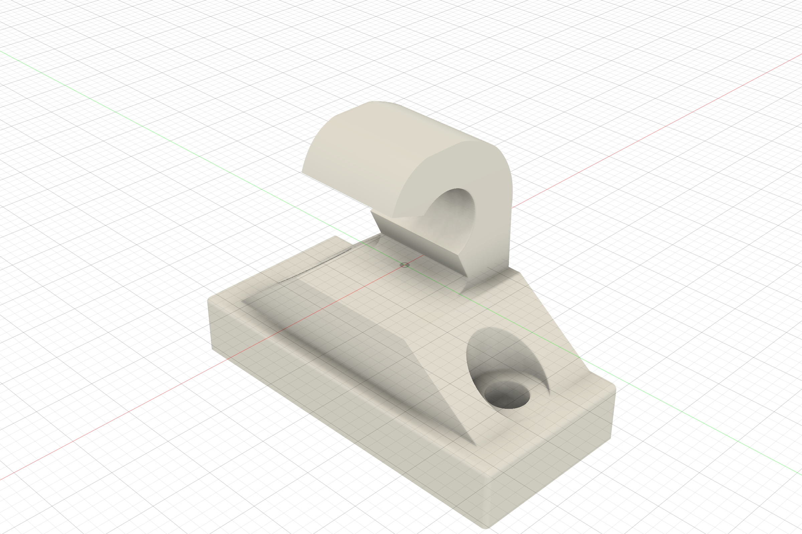
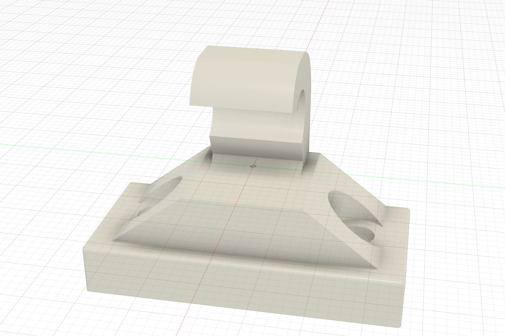
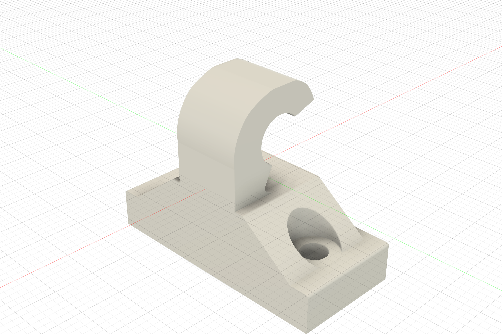
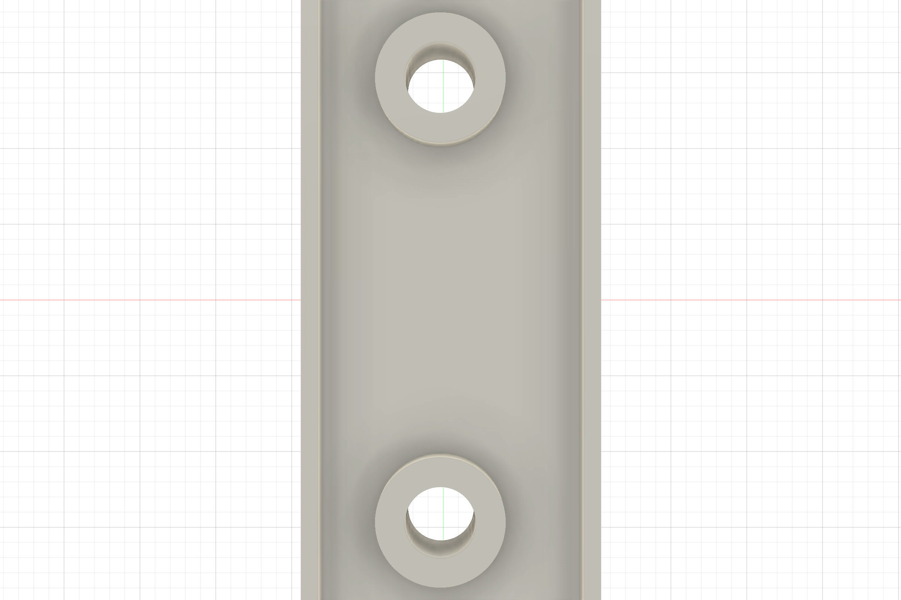
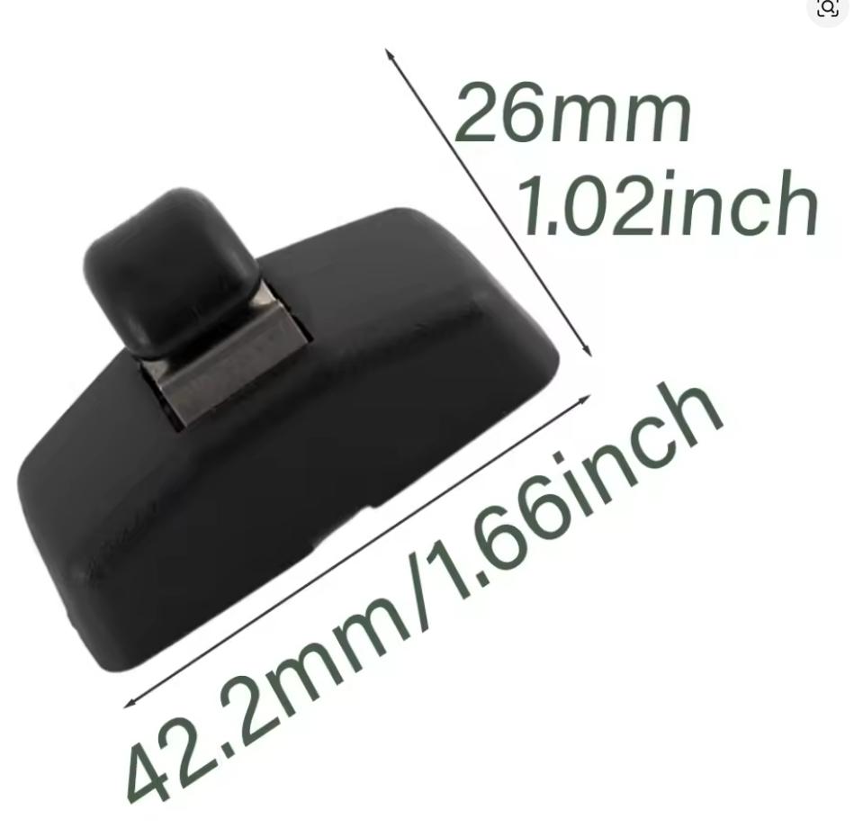
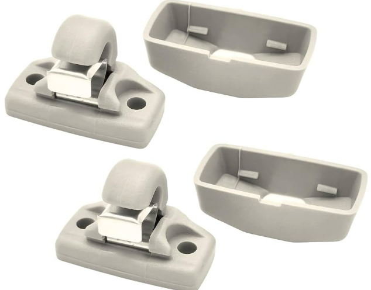
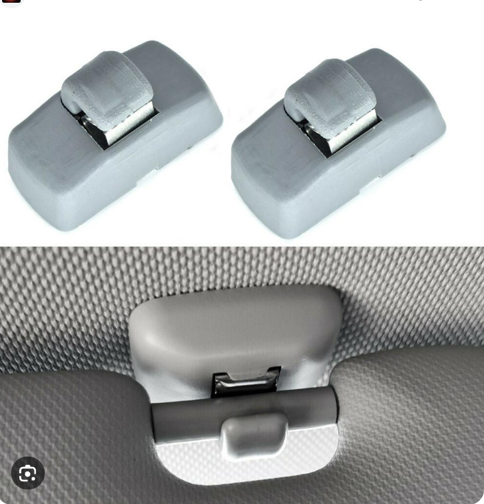

# Project 01: Volkswagen Sun Visor Bracket (Holder Volkswagen)
### Reverse Engineering, 3D Modeling & Additive DFM

## Overview
This project presents the CAD model of the Volkswagen sun visor bracket (`holder volkwagen`). Designed as a direct, high-strength replacement for brittle OEM sun visor retaining clips in Volkswagen Group vehicles.

The model incorporates accurate mounting dimensions, integrated fastener counterbore pockets, and an optimized hook profile for positive engagement of the sun visor retaining rod.

---

## Technical Specifications
| Specification | Value | Engineering Rationale |
|---|---|---|
| **CAD Environment** | Autodesk Fusion 360 | High-fidelity CAD modeling & export |
| **Model Source** | `holder volkwagen` | Custom engineered replacement bracket |
| **Footprint Dimensions** | $37.1 \times 17.1 \times 28.0\text{ mm}$ | Factory-compatible fitment in headliner recess |
| **Fastener Counterbores** | Dual M4 screw pockets | Recessed screw heads flush with upper mounting rim |
| **Rod Retention Cradle** | $\varnothing 8.5\text{ mm}$ cylindrical throat | Smooth engagement & snap retention of visor shaft |
| **Material Recommendation** | PETG / ABS / ASA / Nylon PA12 | High UV resistance, impact strength, and cabin temperature stability |

---

## Detailed Renders

| Front View & Throat | Rear Profile | Bottom View |
|:---:|:---:|:---:|
|  |  |  |

---

## Reference & Teardown Documentation
| Reference Blueprint & Dimensions | OEM Part Inspection | In-Vehicle Assembly |
|:---:|:---:|:---:|
|  |  |  |

---

## Included CAD Files
- **STEP File**: [`holder_volkswagen.step`](holder_volkswagen.step)
- **STL Mesh**: [`holder_volkswagen.stl`](holder_volkswagen.stl)
