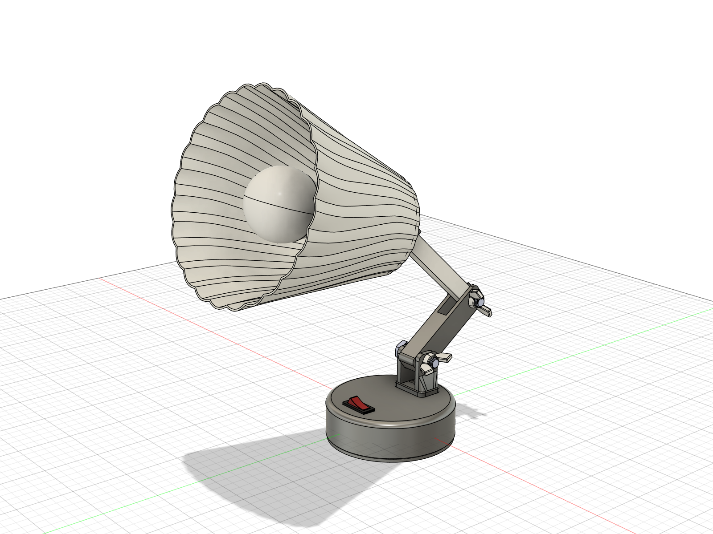
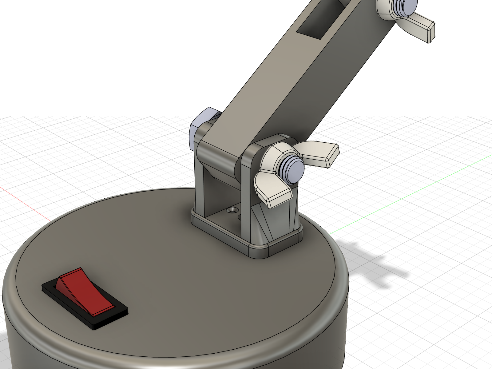
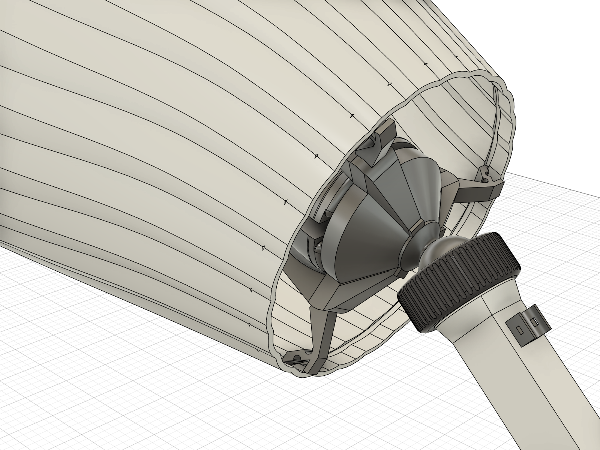

# Project 01: Parametric Fluted Articulated Desktop Lamp
### Multi-Axis Kinematics, Bayonet Locking Mechanism & Parametric Lighting Design

## Overview
A complete, fully articulated parametric desktop luminaire designed from scratch for functional additive manufacturing and ergonomic work illumination. 

The luminaire features a **24-flute flared conical shade**, a **modular 3-lug bayonet twist-lock interface** with positive tactile detents, a **multi-axis spherical neck joint**, **dual cantilever arms with M10 hand-tightening wing nuts**, and a **weighted stable base** with an integrated rocker power switch and concealed internal wiring conduit.

---

## Technical Specifications
| Specification | Value | Engineering Rationale |
|---|---|---|
| **CAD Environment** | Autodesk Fusion 360 | Top-down parametric assembly with kinematic joints |
| **Total Assembly Envelope** | $184 \times 302 \times 344\text{ mm}$ | Compact, fully adjustable desk footprint |
| **Shade Profile** | 24-Rib Conical Shell ($\varnothing 184\text{ mm}$ bell, $\varnothing 83\text{ mm}$ waist) | Aerodynamic loft profiles maximizing light diffusion & structural hoop strength |
| **Modular Mount** | 3-tab bayonet twist-lock with $0.8\text{ mm}$ locking ramp | Rapid, toolless shade removal for bulb replacement and cleaning |
| **Articulated Arms** | Dual-pivot cantilever with M10 bolts & ergonomic wing nuts | Friction-adjustable positioning without requiring wrenches |
| **Neck Kinematics** | Spherical ball joint with knurled locking collar | Omnidirectional aiming of light beam across work surface |
| **Base & Electronics** | $\varnothing 140\text{ mm}$ weighted base + rocker power switch | Low center of gravity with integrated socket clearance |
| **Electrical Hardware** | Lorenzetti 1451-N E27 Ceramic Socket & A60 LED Bulb | Standard industrial electrical components with thermal convection gap |

---

## Mechanical Details & Joint Mechanisms

### 1. Articulated Cantilever Arms & Heavy-Duty Base Mount

- **Cantilever Pivot**: Dual structural arms pivoting on M10 hardware with custom high-leverage wing nuts for rapid position lock.
- **Base Integration**: Recessed pivot clevis with low-clearance rocker switch and internal wire pathways.

---

### 2. Modular Bayonet Neck Mount & Spherical Ball Joint

- **Triple-Lug Bayonet**: Radial engagement arms slide through axial clearance channels and rotate $30^\circ$ into positive retention grooves.
- **Acoustic Locking Detent**: Prevents shade rattle and back-rotation under movement.
- **Ball Swivel Collar**: Fine-threaded locking collar enables smooth multi-axis angle adjustment.

---

## Included CAD Assets & Engineering Models
- **Complete Lamp Assembly STEP**: [`desktop_lamp_assembly.step`](desktop_lamp_assembly.step)
- **Complete Lamp Assembly STL (3D Print & WebGL)**: [`desktop_lamp_assembly.stl`](desktop_lamp_assembly.stl)
- **E27 Ceramic Socket STEP**: [`000_Bocal_Ceramico_Lorenzetti_1451_N_E27.STEP`](000_Bocal_Ceramico_Lorenzetti_1451_N_E27.STEP)
- **LED Bulb E27 STEP**: [`LED Bulb E27.STEP`](LED%20Bulb%20E27.STEP)
