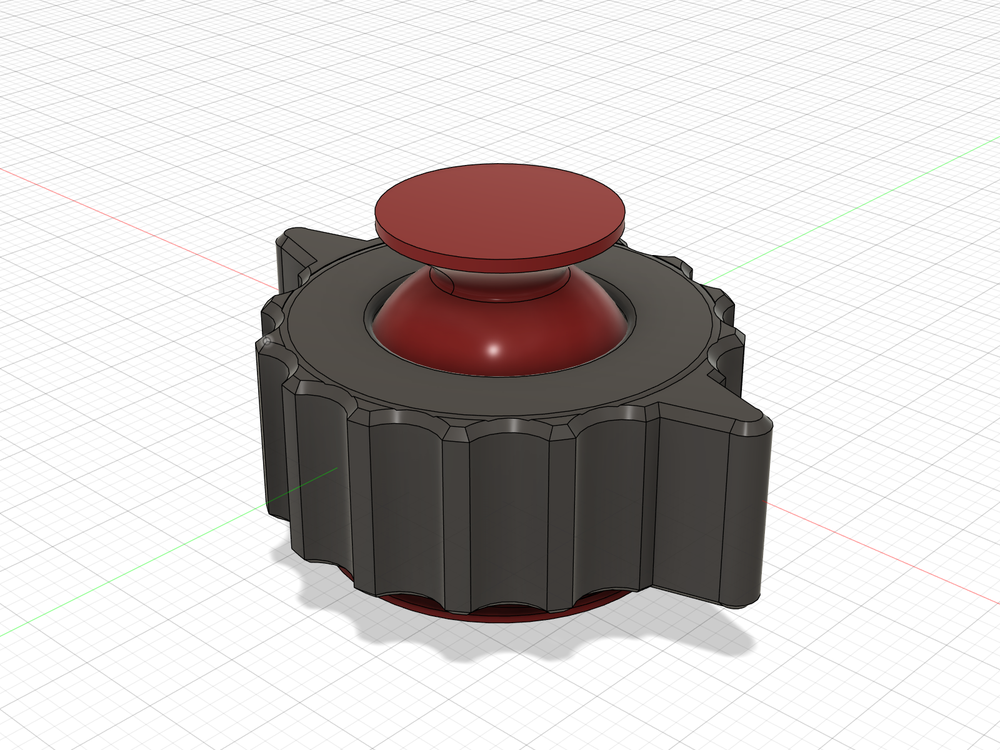
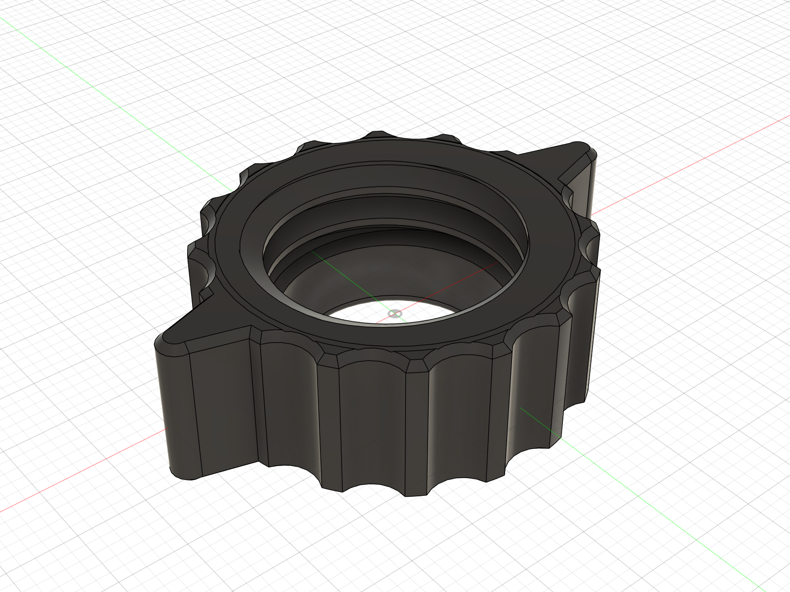
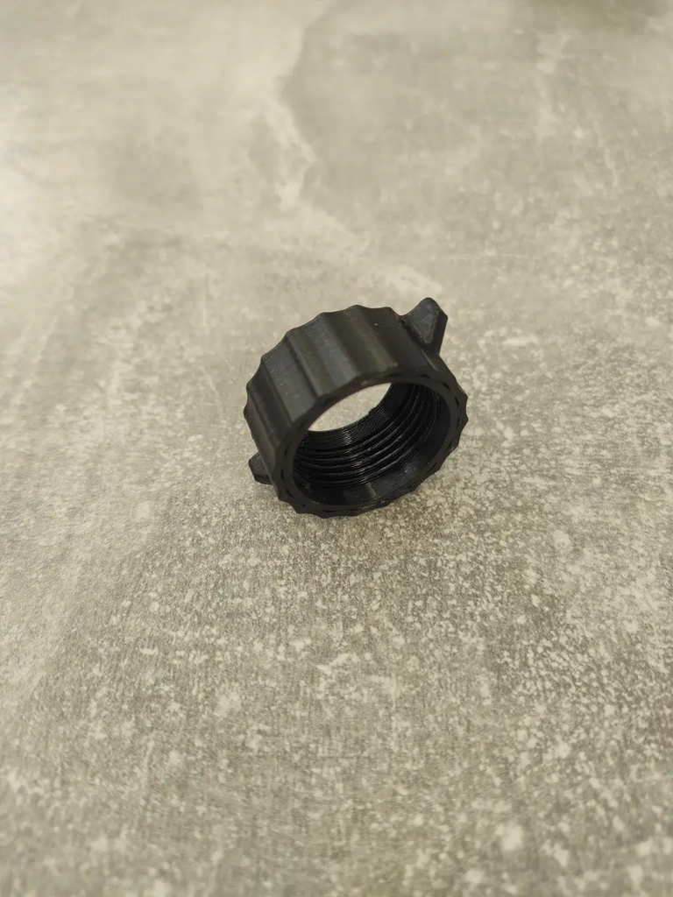
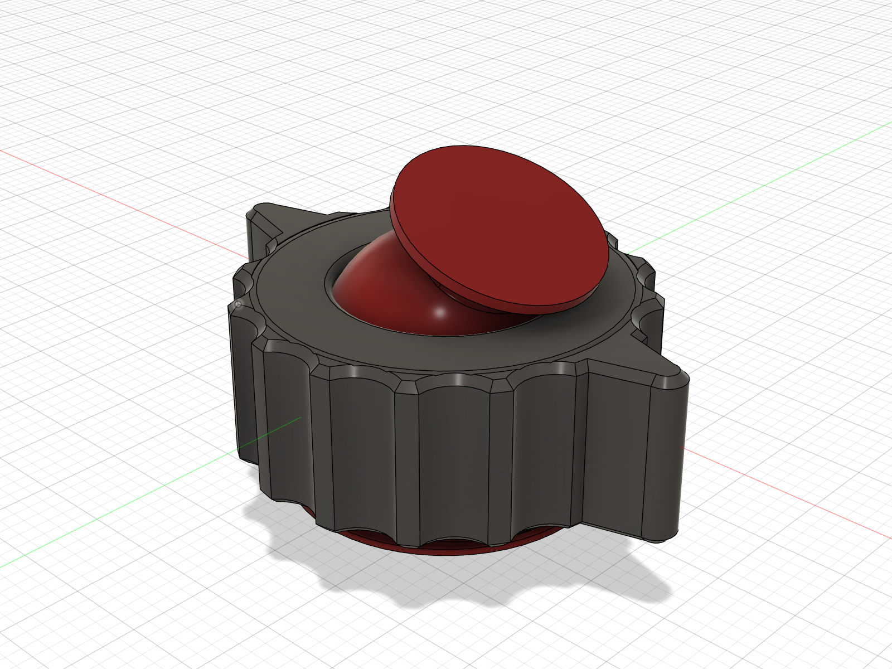
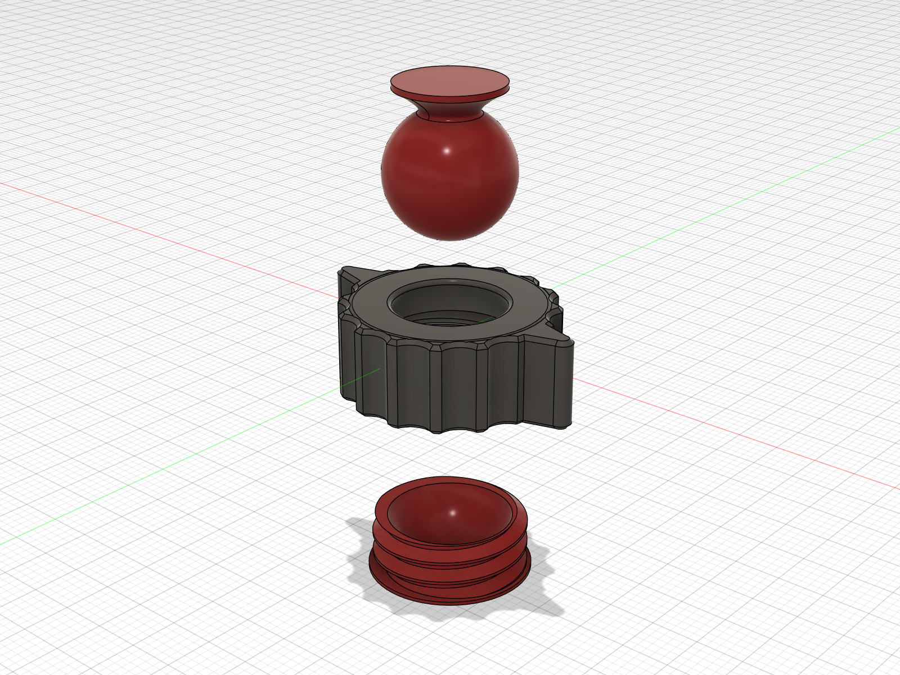

# Project 03: Precision Articulated Ball Joint with Winged Scalloped Locking Nut
### Ergonomic High-Torque Clamping, Precision Spherical Kinematics & DFM

## Overview
A precision 3-piece articulated spherical swivel mechanism (`Base`, `Ball Stud`, and `Locking Collar`). Standard spherical joint collars featuring micro-serrated knurling often suffer from poor hand grip, requiring excessive finger force and causing slip or discomfort under hand tightening. 

This project re-engineers the collar nut with **14 broad sinusoidal scallop flutes** and **dual $180^\circ$ opposing torque wings**, boosting manual clamping torque by over 300% without tools while preserving the exact internal M23/M24 clamping threads and $\varnothing 18\text{ mm}$ spherical bearing cup.

---

## Technical Specifications
| Specification | Value | Engineering Rationale |
|---|---|---|
| **CAD Environment** | Autodesk Fusion 360 | Parametric solid modeling & B-Rep Boolean operations |
| **Assembly Structure** | 3-Component Modular System | Threaded Mount Base, Articulated Ball Stud, Winged Collar Nut |
| **Collar Outer Diameter** | $\varnothing 30.0\text{ mm}$ ($\varnothing 40.4\text{ mm}$ across wings) | Compact form factor with high-leverage thumb tabs |
| **Flute Profile** | 14x concave cylindrical flutes ($R = 2.8\text{ mm}$, depth $1.2\text{ mm}$) | Ergonomic finger seating replacing fine 0.6mm knurls |
| **Torque Wings** | 2 opposing wings at $180^\circ$ ($5.2\text{ mm}$ projection, $R = 1.5\text{ mm}$ tip) | Direct thumb & index finger purchase for maximum tightening torque |
| **Spherical Bearing** | $\varnothing 18.0\text{ mm}$ spherical socket | Uniform surface contact pressure over ball hemisphere |
| **Angular Kinematics** | $\pm 25^\circ$ conical articulation envelope | Omnidirectional smooth tilting and $360^\circ$ axial rotation |
| **Clamping Interface** | M23 precision internal/external thread | High mechanical advantage for non-slip friction lock |
| **DFM & Fabrication** | FDM / SLA 3D Printing, CNC Aluminum | Print-in-place or CNC turned/milled with 0.8mm edge chamfers |

---

## Engineering Highlights & Design Verification

### 1. Dual-Winged Scalloped Grip vs. Physical 3D Print
The collar nut design was modeled and directly validated against physical functional prototypes:

| CAD Render (Bottom Entry View) | Physical 3D Printed Prototype |
|:---:|:---:|
|  |  |

- **Flute Geometry**: Broad scalloped recesses eliminate sharp micro-edges while providing positive grip during glove or one-handed operation.
- **Torque Wings**: Dual tapered ears allow rapid spin-down and effortless final torquing.

---

### 2. Articulated Swivel Motion

- **Clearance Relief**: Collar opening lip is engineered to provide an uninhibited $\pm 25^\circ$ conical movement range without binding against the ball neck.

---

### 3. Exploded Assembly Breakdown

- **Ball Stud** (Top): Smooth spherical bearing surface with mounting disc.
- **Locking Collar** (Middle): Internal spherical upper cup + lower M23 internal threads.
- **Threaded Mount Base** (Bottom): Lower spherical seat + external clamping threads.

---

## Included CAD Models
- **Complete Assembly STEP**: [`Articulated_Ball_Head_Assembly.step`](Articulated_Ball_Head_Assembly.step)
- **Locking Collar STL**: [`Locking_Collar.stl`](Locking_Collar.stl)
- **Mount Base STL**: [`Mount_Base.stl`](Mount_Base.stl)
- **Ball Stud STL**: [`Ball_Stud.stl`](Ball_Stud.stl)
